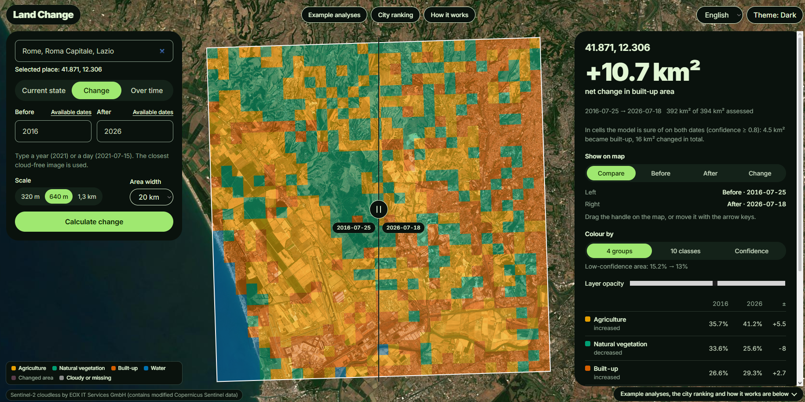
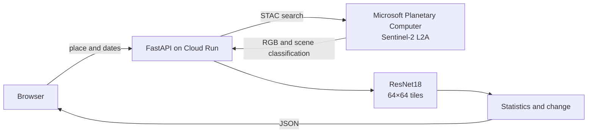
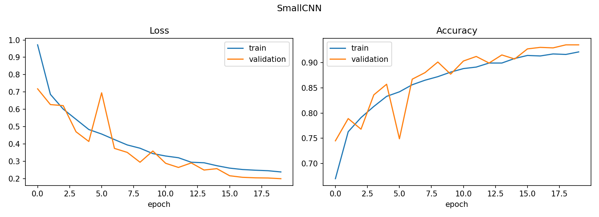
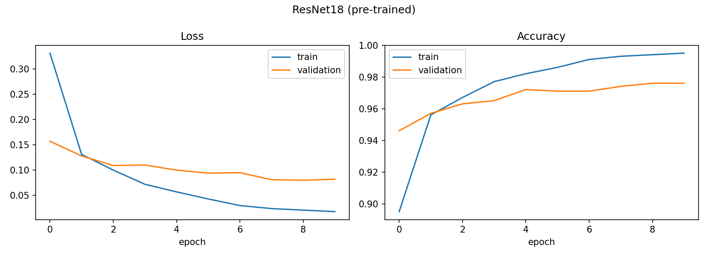
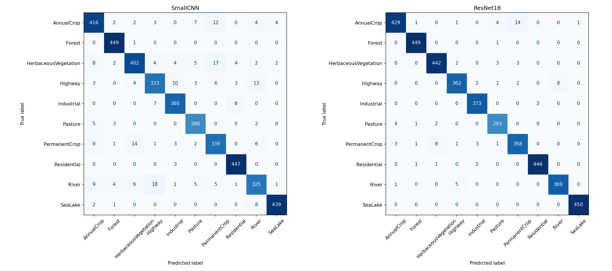
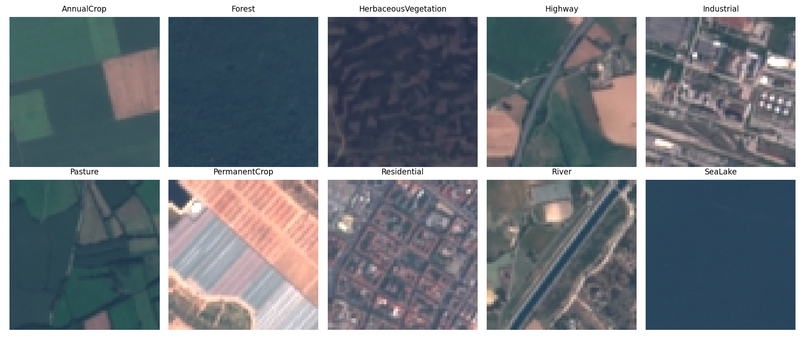

# Land Change

See how cities and land cover changed since 2016, from Sentinel-2 satellite imagery classified by a
neural network.

**Live site: [greenloss.com](https://greenloss.com)**



## What it does

Pick any place on the globe (or search for it) and Land Change analyses a square of 5 to 25 km around it:

- **Current state:** the land cover of the place on one date, as shares of agriculture, natural
  vegetation, built-up area and water.
- **Change:** a cell-by-cell comparison of two dates with the net change in built-up area, the
  transitions between groups in km² and a split view that slides between the before and after images.
- **Over time:** the group shares for every summer in a range of years, as a chart and as a
  time-lapse that plays the years on the map.
- **Dates:** a year means mid-summer of that year; a specific day can be typed, and the Sentinel-2
  acquisition dates available in a year can be listed.
- **Example analyses:** 22 change reports computed in advance, which open without waiting.
- **City ranking:** built-up growth since 2016 in 20 cities around the world.
- **Scale:** 320 m, 640 m or 1.3 km map cells; the map can be coloured by the 4 groups, the 10 model
  classes or the model's confidence.
- **Interface:** English and Turkish, light and dark theme.

## How it works



1. **Pick a place.** A point is chosen on the globe or found with the place search; a square of 5 to
   25 km around it is analysed.
2. **Download the image.** The cloud-free Sentinel-2 image closest to the requested day is read from
   the Microsoft Planetary Computer catalogue.
3. **Classify.** The image is cut into 64×64-pixel squares (640 m at 10 m resolution); the model gives
   each square one of EuroSAT's 10 classes and a confidence.
4. **Compare.** Two dates are compared cell by cell; the changed area and the transitions between
   groups are calculated in km².

## Model

Trained on [EuroSAT](https://github.com/phelber/EuroSAT) RGB: 27,000 Sentinel-2 tiles of 64×64 pixels
in 10 land-cover classes, with a stratified 70/15/15 split. The training notebook is
[`notebooks/land_cover_classification.ipynb`](notebooks/land_cover_classification.ipynb).

| Model | Parameters | Epochs | Validation accuracy | Test accuracy |
|---|---|---|---|---|
| Small CNN (from scratch) | 94,986 | 20 | 93.5% | 93.8% |
| ResNet18 (ImageNet pre-trained) | 11,181,642 | 10 | 97.6% | 98.1% |

The pre-trained ResNet18 cuts the error rate to a third and is the model the application uses.

| Small CNN | ResNet18 |
|---|---|
|  |  |



**Error analysis.** Most remaining errors are inside agriculture (annual crop, permanent crop,
pasture) and between highway and river, which both appear as thin lines in a tile. Sea/lake, forest
and residential are the most reliable classes.

**Caveat.** EuroSAT tiles are cut from larger scenes, so a random split places neighbouring tiles in
both the training and the test set. Accuracy on a region the model has never seen is likely lower than
measured here.



## Engineering decisions

- **Four groups.** The 10 EuroSAT classes are merged into agriculture, natural vegetation, built-up
  and water; reports and change are read through these groups.
- **Water comes from the satellite's own classification.** With RGB alone the model confused dark sea
  with forest and once reported 41 km² of sea turning into vegetation. Sentinel-2's scene
  classification layer, derived from infrared bands, now decides what is water.
- **Cloudy and missing cells are left out.** A cell with more than 20% cloud, cloud shadow or missing
  data is excluded; the cloud check is done inside the selected square, not over the whole scene.
  In a comparison, only cells usable on both dates are counted.
- **Numbers at one scale.** Statistics and change are always computed on the model's native 640 m
  cells, so the chosen map scale changes how the result looks, never what it says.
- **Confidence filter and net change.** The main figure is the net change in built-up area over all
  usable cells. Below it, the built-up gain is also given for cells the model is sure of on both
  dates (confidence ≥ 0.8 by default), and a warning is shown when the two figures disagree strongly.
- **Season matching.** Comparing July with September for the same place nearly doubled the measured
  change, so a bare year always means mid-summer (20 July in the north, 20 January in the south) and a
  warning is shown when the two images are more than 45 days apart in the season.
- **Prior knowledge.** Cells in open water far from the shore count as water and cells on glaciers are
  left out, using Natural Earth; deserts and mountain ranges only get a warning. The correction can be
  switched off.

## Security and privacy

- **Rate limit:** 90 API requests per client address in 10 minutes by default (`RATE_LIMIT`,
  `RATE_WINDOW_S`); further requests get `429 Too Many Requests`.
- **Restricted cross-origin access:** the site and the API share one origin; CORS allows only origins
  listed in `ALLOWED_ORIGINS` and localhost for development. Only `GET` is accepted.
- **Security headers** on every response (`X-Content-Type-Options`, `X-Frame-Options`, HSTS,
  `Referrer-Policy`, `Permissions-Policy`, `Cross-Origin-Opener-Policy`) and a strict Content Security
  Policy in the page that allows only this site, the geocoder and the basemap.
- **Self-hosted font and map library:** Inter and MapLibre GL JS are served from the site itself.
- **What leaves the browser:** search text goes to Photon (komoot) for place search; the chosen
  location goes to this project's API; the globe basemap loads from EOX. There are no accounts,
  cookies or tracking; the browser stores only the language, theme and correction choice.
- Interactive API documentation is off unless `API_DOCS=1` is set.

## Limitations

- EuroSAT has no greenhouse or bare-soil class: greenhouses can show up as built-up, bare soil as
  built-up or agriculture.
- The model was trained on European images; results elsewhere are less reliable.
- The model decides on a 640 m window; the 320 m scale makes the map finer but not the model sharper.
- Sentinel-2 imagery starts in mid-2015; earlier dates are not supported.
- Every value is a model estimate, not a measurement.

## Project structure

```
backend/     FastAPI service (app/, tests/, Dockerfile, requirements.txt)
docs/        the site: index.html, app.js, i18n.js, styles.css, data/, vendor/
scripts/     data builders: example analyses, city ranking, Natural Earth prior
notebooks/   model training on EuroSAT
assets/      images used in this README
```

## Run it yourself

**Model weights.** Download `resnet18.pt` from the
[releases page](https://github.com/DuranOzcelik/land-change/releases) and put it at
`backend/weights/resnet18.pt`.

**Backend**

```bash
cd backend
pip install torch torchvision --index-url https://download.pytorch.org/whl/cpu
pip install -r requirements.txt
uvicorn app.main:app --reload       # http://localhost:8000
pytest -q                           # smoke tests; need neither PyTorch, the weights nor network
```

**Front end**

```bash
python -m http.server 8080 --directory docs
```

Open `http://localhost:8080`. Opened from localhost, the page uses the public API;
`?api=http://localhost:8000` points it at a local backend instead.

**Deploy to Cloud Run** (site and API in one service)

```bash
cd backend
rm -rf static && cp -r ../docs static
gcloud run deploy land-change --source . --region europe-west1 \
  --allow-unauthenticated --max-instances 1 --memory 2Gi --cpu 2 --timeout 300 --concurrency 4
```

## Data and credits

- **EuroSAT** (Helber et al.), MIT license.
- **Copernicus Sentinel data**, accessed through the
  [Microsoft Planetary Computer](https://planetarycomputer.microsoft.com); free, full and open access
  under EU law. Contains modified Copernicus Sentinel data.
- **Sentinel-2 cloudless** basemap by EOX IT Services GmbH (contains modified Copernicus Sentinel data
  2020), [CC BY-NC-SA 4.0](https://creativecommons.org/licenses/by-nc-sa/4.0/) for non-commercial use.
- **Natural Earth**, public domain.
- **Photon** geocoder by komoot, with data © OpenStreetMap contributors,
  [ODbL](https://www.openstreetmap.org/copyright).
- **MapLibre GL JS**, BSD 3-Clause license (`docs/vendor/maplibre-LICENSE.txt`).
- **Inter** typeface, SIL Open Font License 1.1 (`docs/vendor/fonts/Inter-LICENSE.txt`).

## License

The code is released under the [MIT License](LICENSE). Data sources keep their own licenses, listed
above.

## Author

Duran Özçelik · [GitHub](https://github.com/DuranOzcelik)
